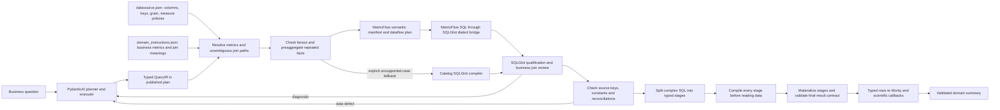

# Semantic query compilation

New planner outputs require `query_language: semantic` and a Pydantic `QueryIR`
in each SQL step's `logical_query`. The planner's native/tool structured output
is validated against catalog definitions and output aliases before publication.
The host puts schema inspection first and SQL producers before Python consumers;
it can insert schema verification when absent. Unknown producer references still
fail validation. Ordering does not change metrics or resolve business ambiguity.
Scalar aggregate queries have one output row, an empty result grain and no entity
population contract; the host derives these properties instead of asking the LLM
to attach customer IDs to an aggregate. This does not alter the selected metrics.
The planner's wire schema restricts base tables, metric IDs and relationship IDs
to the current workspace catalog. Relationship IDs are registry names, not SQL
join expressions; an invented name fails structured validation before compilation.
The executor then calls `run_sql(step_id)`; its initial tool schema exposes no
query or SQL text. Compiler feedback can expose `query` for an explicit logical
revision. Manually constructed semantic steps without a published query accept
`run_sql(step_id, query=...)`. The compiler contains
no credit-card or SmartWealth table names, routing expressions or business formulas.



SQL-only requests proceed from the validated rows to presentation. The existing
pipeline graph still controls stage order and preview exits. Monty continues to
execute generated Python using native SQL values and its allowlisted SciPy bridge.
Complex SQL is generated and executed as dependent materialized stages; see
[staged SQL](sql-staging.md) for thresholds, limits and trace artifacts.

Both workspaces select MetricFlow in `datasource.json`. The existing catalog
compiler prepares safe source relations; MetricFlow plans metrics and entity
joins over them. Explicit unsupported cases can use the configured catalog
fallback, with a trace receipt. See [MetricFlow](metricflow.md) for supported
ratios, cumulative definitions, compatibility limits and native audit artifacts.

## Catalog ownership

`sources.<source>.semantic_tables.<table>` in `datasource.json` declares:

- `grain`, `primary_key` and optional `snapshot_column`.
- Column `measures` with `aggregation`, `additive_over`, `non_additive_over`,
  `consistency`, `null_policy` and a description. Additive sums retain decimal money.
- Optional `reconciliations`: group keys, a `sum_column`, a `constant_column` and
  absolute tolerance. These check conservation of flows at the configured grain.

Relationship entries provide every key pair. Their `required_preaggregation`
maps a repeated table to the grain at which it must be collapsed before joining.
Primary-key guards check the observed data; configured cardinality alone does
not establish observed uniqueness. A many-to-many additive join without an
adequate reduction is rejected with `UNSAFE_FANOUT`.

`profiles.<profile>.semantic_metrics` in `domain_instructions.json` declares named
business measures. A leaf metric selects a table/column and inherits its column
aggregation. Catalog-owned `filters` make conditional measures; `required_filters`
constrain the whole observation population. Derived metric `formula` expressions
reference other named metrics. `horizon`, `minimum` and `maximum` constrain
probability definitions. Missing definitions fail with `UNDEFINED_METRIC`.
Fixed metric horizons are inherited when omitted from QueryIR; an explicit
conflicting horizon is rejected. The resolved horizon is retained in the
published logical query and compilation evidence.

A `cumulative` metric names a base `input_metric`, a `period_aggregation`
(`last`, `first` or `average`) and optionally a rolling window or grain-to-date
period. MetricFlow owns its time-spine/window planning. The catalog-only compiler
rejects cumulative requests instead of returning a non-cumulative value.

The LLM cannot override an aggregate in QueryIR. A catalog-defined count-distinct
can count entity IDs without summing intermediate counts. Every table also has a
`<table>.__count` observation-count metric. A zero denominator returns NULL.
`constant` uses MAX only after a guard proves that non-null values agree; mixed
null/non-null values fail, while all-null values are allowed unless configured
with `null_policy: reject`.

Latest-common time selection means the maximum **intersection** of available
period values. It is not the minimum of each table's maximum date. An empty
intersection is a data error. Source snapshot filters run inside each source
before its left join so absent financial facts do not discard registered customers.
Range endpoints are inclusive start and exclusive end. Cross-table latest-common
requires compatible period columns; it does not infer a calendar alignment
between timestamp events and monthly snapshots.

Identity grouping keys and a selected single snapshot can retain an equivalent
key across a configured LEFT join from its preserved side to matched facts on
the nullable side. For example, grouping an origin's month retains that month
on matching exposure facts. The reverse implication is rejected: missing right
rows can combine different left periods into a NULL group. This check uses the
actual oriented join keys, not matching column names.

For a declared whole-population contract, the compiler anchors the left joins at
that population's table and projects its registered identity. Related-table filters
run inside their source subqueries before joining, so status, currency and period
filters cannot remove zero-activity population members. A filter on the population
itself conflicts with a whole-population contract and is rejected. A range ending
on June 30 excludes that day; use July 1 to include all of June. Conflicting source
date filters and time selections are rejected before publication.

## Projection aliases and correction feedback

Aliases are unique across `dimensions`, `metrics` and `calculations`. Select each
output-contract alias once. A metric's `metric` is its catalog ID, while `name` is
the output alias; these are different responsibilities.
Required canonical grain aliases remain projected when the model gives the same
source field an additional label. In particular, renaming a month field to a
synthetic key cannot remove a required month output. A composite identifier needs
an explicit calculation; the grain tuple itself is already an observation key.
For a configured observation policy, the host completes an omitted projection
whose required alias exactly names a registered catalog metric. If the contract
requests an alias listed in `observation_policy.identity_aliases`, the host constructs the complete identity with
the typed `key` calculation. The length-prefixed encoding handles separators in
values and returns NULL if any component is NULL. These changes are recorded as
`CATALOG_OUTPUT_BOUND` and `OBSERVATION_IDENTITY_BOUND`; unregistered business
metrics and ambiguous non-identity outputs still fail validation. MetricFlow
requests each underlying dimension/metric once even if several outer output
aliases refer to it.
Identity roles come from this explicit metadata, not guesses based on column names
or free-text descriptions. Other required fields still need their own selected
projection or calculation.

The host removes identical repeated projections and identity reassignments such
as a calculation named `total` that only references an already selected `total`.
These changes preserve values and appear as `QUERY_IR_NORMALIZED` in trace logs.
Different expressions sharing one alias are rejected; the host does not rename
them or guess which expression was intended.

`query_outputs_empty` means both dimensions and metrics were empty.
`query_alias_collision` names the conflicting alias and exact locations, for
example `metrics[0]` and `calculations[0]`. `PLAN_REJECTED` and the next model
handoff include the current selected aliases and required output aliases, so
correction feedback identifies the actual defect instead of repeating a generic
"unique aliases" message. This uses Pydantic's
[custom validation errors](https://docs.pydantic.dev/latest/concepts/validators/#raising-validation-errors).

## Example logical selections

The planner can declare monthly origin observations with these selections;
no aggregate functions or join keys come from the model:

```json
{
  "base_table": "cc_delinquency_monthly",
  "dimensions": [
    {"name": "month", "field": {"table": "cc_delinquency_monthly", "column": "month"}},
    {"name": "variant_id", "field": {"table": "cc_delinquency_monthly", "column": "variant_id"}},
    {"name": "segment", "field": {"table": "cc_delinquency_monthly", "column": "segment"}},
    {"name": "currency", "field": {"table": "cc_delinquency_monthly", "column": "currency"}},
    {"name": "dpd_bucket", "field": {"table": "cc_delinquency_monthly", "column": "dpd_bucket"}}
  ],
  "metrics": [
    {"name": "exposure_amount", "metric": "exposure_amount"},
    {"name": "probability_of_default", "metric": "probability_of_default"},
    {"name": "loss_given_default", "metric": "loss_given_default"}
  ],
  "time": {"selection": "latest_common"},
  "metric_horizons": {"probability_of_default": "one_month"}
}
```

`exposure_amount` requires a non-default population by its catalog definition.
`risk_transition` collapses destination rows to monthly origin keys. Defaulted
transition balances are conditionally summed. Opening balances are checked for
constancy and collapsed once, so the default probability denominator cannot be
inflated by the destination row count. LGD comes from the exposure cohort.
The probability metric also excludes already-defaulted origin cohorts from its
numerator and denominator when reporting a broader variant/segment breakdown.
The catalog also requires destination balances to reconcile to opening balance
within INR 0.01. Missing source cohorts remain undefined, not zero-probability
observations. The SQL output contract determines whether undefined values can
proceed to the requested calculation.

The seeded block-default simulation remains a model assumption for demonstration,
not a validated model of individual borrower defaults. The compiler does not
establish the predictive validity of that assumption.

## Supported boundary

QueryIR supports catalog metrics and formulas, source predicates, identity/day/
month/year dimensions, time selection, ordered outputs and sequential arithmetic
or concatenation of preceding output aliases. The compiler builds each calculated
projection in its own scope, preventing same-SELECT alias errors.

Safe reductions use column policies. Repeated constants require a consistency
rule; snapshot measures retain their non-additive time dimension or select a
single snapshot. AVG and count-distinct are not silently combined across required
preaggregation: unsupported reductions fail rather than averaging averages or
summing distinct counts. Multiple equally short join paths require explicit
configured relationship IDs to choose the business path.

Relationship selections are route hints, not an allowlist that deletes the rest
of the catalog graph. A complete selected route is preserved. If selected hints
are incomplete, the compiler examines full-catalog shortest paths and can complete
a unique route or select the unique route distinguished by the hints. Ties remain
errors; it never invents keys or crosses workspace boundaries. Ambiguity diagnostics
include complete `candidate_relationship_ids`, supplied hints and the metrics that
require the target table. Truly disconnected sources still report `NO_JOIN_PATH`.
Planner repair handoffs include those diagnostics and the selected metric definitions.

This is a bounded relational compiler, not a complete SQL language. Arbitrary SQL,
user-defined functions, arbitrary window operations and correlated subqueries are not IR
escape hatches. Add a typed, validated operation or a catalog definition when
needed. Undefined semantics are reported, not repaired by silently switching to
raw SQL. Old saved/manual plans default to `legacy_sql`; host-selected immutable
recipes and the direct read-only `DataSources.query()` API retain their checks.

Derived multiplication/division uses float64 to avoid Decimal128 precision growth;
it is approximate. Source values and additive monetary sums remain Decimal.
Monty still receives the actual computed Arrow/Python types, not JSON strings.

## Verification and measurement

`QUERY_COMPILED` traces store the IR, catalog hash, chosen relationships and
preaggregation grains. `ExecutionResult.validation_receipts` retain the same
provenance. `ExecutionResult.sql_metrics` and `SQL_KPI` trace records separate
logical-plan acceptance, SQLGlot validation, DataFusion compilation, actual
execution and output-contract acceptance per attempt. `first_attempt` identifies
the initial proposal; no new LLM call is added for these checks. Global request,
tool and correction budgets are unchanged. Pydantic tool-argument validation runs
before the tool body; engine KPI records describe proposals that reach compilation,
and include the tool retry index so earlier argument failures are visible.
Planner repair handoffs replace the previous schema diagnostic with the latest
semantic failure, preventing an already corrected error from dominating the next
generation turn.

Compilation success is not proof of business correctness. Golden tests compare
credit-risk probabilities/exposures, customer financial features and SmartWealth
AMC values/counts to independently written reference SQL. A different-domain
synthetic catalog covers repeated balances, missing destinations, zero denominators,
missing cohorts, null measures, duplicate keys and non-overlapping periods. A
FunctionModel integration test checks typed tool schema, diagnostic feedback,
native rows reaching real Monty and retained KPI receipts without a network model.

```sh
uv run python -m unittest discover -s tests -p test_semantic_query.py
uv run python -m unittest discover -s tests -p test_metricflow_adapter.py
```

The implementation uses [PydanticAI structured outputs](https://pydantic.dev/docs/ai/core-concepts/output/)
and [SQLGlot AST builders](https://sqlglot.com/sqlglot/expressions/query.html).
